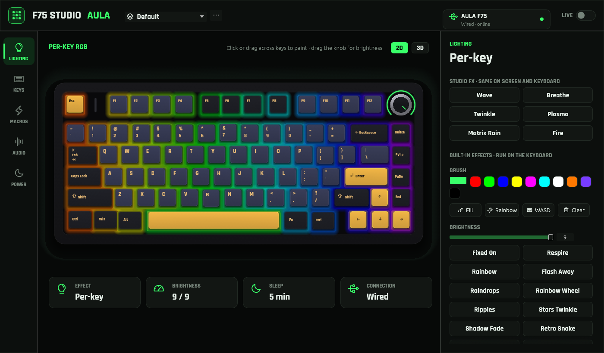
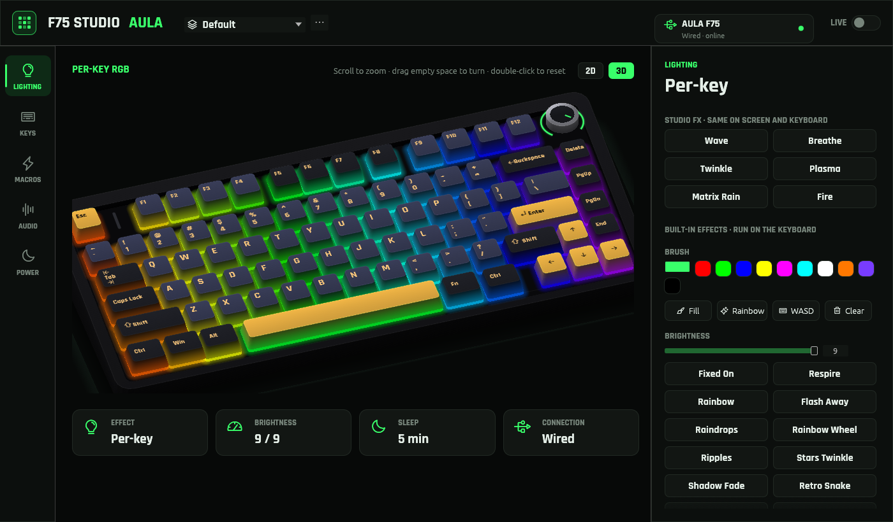
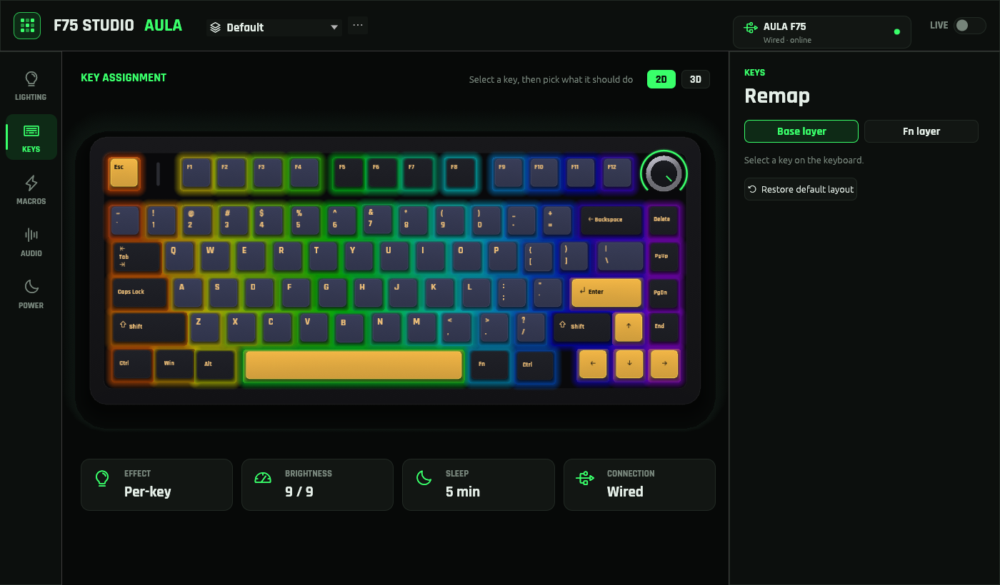
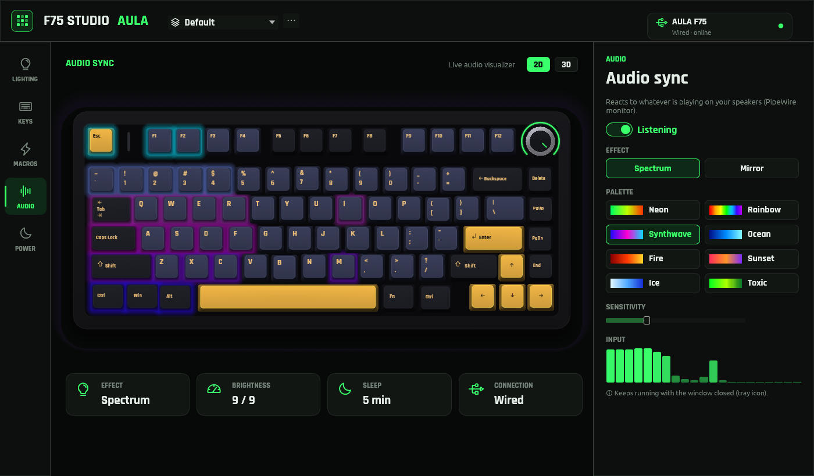

# F75 Studio

> **Fork notice:** this is a fork of [trenbolone1122/aula-f75-linux](https://github.com/trenbolone1122/aula-f75-linux). All credit for the original work goes to its author.

A native Linux app for the AULA F75 keyboard: per-key RGB, hardware effects,
live effects and audio sync, key remapping, macros, profiles and sleep control,
over the USB-C cable or the 2.4 GHz receiver.

AULA only ships a Windows driver. The protocol was recovered by decompiling it
with Ghidra and checked on a real F75. See [docs/PROTOCOL.md](docs/PROTOCOL.md)
and [tools/ghidra](tools/ghidra).



| 3D view | Keys | Audio sync |
|---|---|---|
|  |  |  |

## Build and run

### Fedora, Debian / Ubuntu, Arch (one command)

```bash
git clone https://github.com/trenbolone1122/aula-f75-linux.git
cd aula-f75-linux
./install.sh
```

While the repository is private, clone it with the GitHub CLI instead:
`gh auth login` once, then `gh repo clone trenbolone1122/aula-f75-linux`.

`install.sh` asks for your password when it needs sudo, then:

1. Installs build tools and libraries with your package manager (`dnf`, `apt` or `pacman`).
2. Checks Rust. If the system's Rust is older than 1.95, it installs current Rust
   with the official rustup installer into `~/.cargo` (no sudo).
3. Builds the app (the first build takes a few minutes).
4. Installs `~/.local/bin/f75-studio` and an "F75 Studio" app menu entry.
5. Adds a udev rule so your user can use the keyboard without sudo.
6. On GNOME, installs (`dnf`, `apt` or `pacman`) and enables the AppIndicator
   extension for the tray icon (skipped on Ubuntu where it is built in).

Then open **F75 Studio** from the app menu, or run `f75-studio`. On GNOME, log
out and back in once after the first install to see the tray icon.

### Build by hand (any distro)

Install Rust 1.95 or newer ([rustup.rs](https://rustup.rs)) and these packages:

* Fedora: `gcc pkgconf-pkg-config systemd-devel hidapi-devel libxkbcommon-devel wayland-devel mesa-libGL-devel libX11-devel pulseaudio-libs-devel`
* Debian / Ubuntu: `build-essential pkg-config libudev-dev libhidapi-dev libxkbcommon-dev libwayland-dev libgl1-mesa-dev libx11-dev libpulse-dev`
* Arch: `base-devel hidapi libxkbcommon wayland mesa libx11 libpulse`

```bash
cargo build --release
sudo install -Dm644 packaging/70-aula-f75.rules /etc/udev/rules.d/70-aula-f75.rules
sudo udevadm control --reload-rules && sudo udevadm trigger
./target/release/f75-studio
```

Replug the cable or receiver once after adding the udev rule. To install the
binary: `install -Dm755 target/release/f75-studio ~/.local/bin/f75-studio`.

### Update

```bash
git pull
./install.sh
```

The installer stops a running copy first.

### Uninstall

```bash
./uninstall.sh            # keeps your profiles
./uninstall.sh --purge    # also deletes ~/.config/f75-studio
```

Lighting, remaps and macros already written to the keyboard stay on it.

## First run

* Use the USB-C cable for everything. The 2.4G receiver supports everything
  except live effects, audio sync and macros.
* If the app says access is blocked, click **Fix permissions** (one password
  prompt), or replug the cable or receiver once.
* Changes are sent to the keyboard as soon as you make them.

## Features

* **Profiles:** switch, create, duplicate, rename and delete from the top bar or
  the tray. A profile holds lighting, sleep, both key layers and macros.
* **Lighting:** paint keys by clicking or dragging, presets, and 18 hardware
  effects with brightness, speed and colour.
* **Studio FX** (USB-C): Wave, Breathe, Twinkle, Plasma, Matrix Rain and Fire at
  about 50 fps, with 8 palettes.
* **Audio sync** (USB-C): Spectrum and Mirror, driven by whatever is playing.
* **2D and 3D views** of the keyboard in its real colours, drawn in your F75's
  colourway (pick it next to the 2D/3D switch; the keyboard can't report it). In 3D: scroll or pinch
  to zoom, drag empty space to turn, middle-drag to pan, double-click to reset.
* **Keys:** remap any key on the base or Fn layer; restore the factory layout
  at any time.
* **Macros** (USB-C): text the keyboard types by itself, even without the app.
* **Power:** sleep timeout, including Never.
* **Background:** close the window and live effects keep running; the tray icon
  has profiles, effects and Quit.

## Command line

```
f75-studio                      open the app (or bring up the running one)
f75-studio quit                 stop the copy running in the background or tray
f75-studio doctor               guided hardware test, saves a report
f75-studio probe                read only: connection and LED settings
f75-studio keymap [0|1]         read only: base or Fn layer
f75-studio solid R G B          every key one colour
f75-studio effect ID [BRIGHT 0-9] [SPEED 0-4] [COLOUR 0-7]
f75-studio sleep SECONDS        0 = never
f75-studio macro F12 "gg wp"    assign a text macro (USB-C)
f75-studio fix-permissions      install the udev rule
```

Add `--dry-run` (and `--wired`) to print the packets instead of sending them.
Commands other than `quit` refuse to run while the app is open.

## Status

| Connection | Effects and per-key | Remap | Macros | Studio FX and audio | Profiles |
|---|---|---|---|---|---|
| USB-C cable | Yes | Yes | Yes | Yes | Yes |
| 2.4G receiver | Yes | Yes | No | No | Yes |
| Bluetooth | View only | No | No | No | No |

Settings made over the cable or 2.4G stay on the keyboard and keep working over
Bluetooth.

## Troubleshooting

| Problem | Fix |
|---|---|
| "Access blocked" or Permission denied | Click **Fix permissions**, or replug the cable or receiver |
| Keyboard not found | Use the cable or the 2.4G receiver, then run `f75-studio doctor` |
| Studio FX, audio or macros greyed out | They need the USB-C cable |
| No tray icon on GNOME | Log out and back in once after installing |
| Audio sync doesn't react | Check that sound plays through the default output |
| A command says the app is running | Run `f75-studio quit` first |

## Credits

Fonts: Rajdhani (SIL Open Font License, `assets/fonts/OFL.txt`). Icons: Phosphor.
GUI: egui / eframe.
